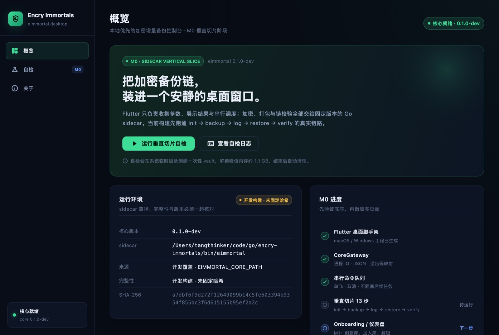
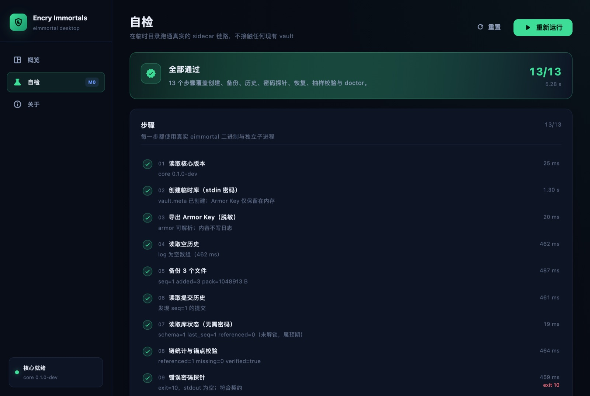

# encry-immortals-ui

[`encry-immortals`](https://github.com/tangthinker/encry-immortals)（eimmortal）的桌面客户端，目标平台 **macOS 12+ / Windows 10+**。

> 状态：**M0 垂直切片已完成**（2026-10-21）。Flutter 壳层已通过真实 Go sidecar 跑通
> `init → backup → log → restore → verify`；真实 vault 的 onboarding / 仪表盘属于 M1。
> 技术结论见 [技术选型](docs/tech-selection.md)，进程与 JSON 契约见 [集成契约](docs/integration-contract.md)，
> 每轮开发记录见 [开发日志](docs/devlog.md)。





## 已实现

- **CoreGateway**：定位 sidecar、SHA-256 校验、argv 构造、stdin 密码/Armor Key、并发读 stdout/stderr、JSON + 退出码映射、取消与超时。
- **串行命令队列**：所有命令单飞，任务失败不阻塞队列，支持取消当前子进程。
- **M0 自检**：在系统临时目录创建一次性 vault，13 个步骤覆盖创建、导出 Key、空历史、备份、链校验、错误密码探针、恢复、逐文件 SHA-256 比对、抽样校验、`doctor --chain`；支持取消。
- **桌面壳层**：概览 / 自检 / 关于三页；运行环境、完整性、步骤、实时日志与失败现场展示。
- **安全处理**：密码只走 stdin；敏感命令输出不写日志；环境变量白名单；debug 才允许 `EIMMORTAL_CORE_PATH`。

## 开发

### 前置

- Flutter 3.47.5 / Dart 3.13.4（本机已验证）
- Xcode 与 CocoaPods（macOS）
- Go 1.27+（仅构建上游 sidecar 时需要）
- 上游核心仓库 + `bin/eimmortal`（当前基线 `v0.1.5-4-g340cade`，报 `0.1.0-dev`）

### 运行

```bash
flutter --no-version-check pub get

# 开发期把 sidecar 指向上游构建产物
EIMMORTAL_CORE_PATH=/Users/tangthinker/code/go/encry-immortals/bin/eimmortal \
  flutter --no-version-check run -d macos
```

> 本机访问 github 会超时，导致 `flutter --version` 的版本检查卡住；命令统一加 `--no-version-check`。
> `EIMMORTAL_CORE_PATH` 只在 debug 构建生效，release 构建会忽略。

或者直接构建并启动：

```bash
flutter --no-version-check build macos --debug
open -n "build/macos/Build/Products/Debug/Encry Immortals.app" \
  --env EIMMORTAL_CORE_PATH=/Users/tangthinker/code/go/encry-immortals/bin/eimmortal
```

### 测试

```bash
flutter --no-version-check analyze
flutter --no-version-check test

# 真实 sidecar 集成测试（约 5–6 s，init 峰值内存约 1.1 GB）
RUN_CORE_INTEGRATION=1 \
EIMMORTAL_CORE_PATH=/Users/tangthinker/code/go/encry-immortals/bin/eimmortal \
  flutter --no-version-check test test/integration
```

不启动 UI 的垂直切片：

```bash
dart run tool/vertical_slice.dart /path/to/eimmortal
```

### Debug 截图 / 自动自检

仅 debug 构建生效：

```bash
open -n "build/macos/Build/Products/Debug/Encry Immortals.app" \
  --env EIMMORTAL_CORE_PATH=/path/to/eimmortal \
  --env EIMMORTAL_AUTORUN_SELFTEST=1 \
  --env EIMMORTAL_SCREENSHOT=/tmp/eimui.png \
  --env EIMMORTAL_SCREENSHOT_DELAY=12
```

## 架构

```text
Flutter UI (macOS / Windows)
  ├── app/       概览 / 自检 / 关于，Riverpod 状态
  ├── core/      纯 Dart：CoreGateway / CommandQueue / 模型 / 配置 / 垂直切片
  └── tool/      终端版垂直切片
        │  stdin: password 或 Armor Key；stdout: JSON；stderr: 人类进度
        ▼
eimmortal sidecar（固定版本、随包签名、构建期记录 SHA-256）
        │
        ├── vault/       控制平面
        └── TargetDir/   密文数据
```

**UI 不实现任何加密、索引、pack/journal 逻辑**；所有数据事实以 CLI 的 JSON 为准。

## 已知限制

- 尚未接入真实 vault 的创建/加入/解锁 UI；M0 只跑临时库自检。
- 未做单实例锁、退出保护、锁残留修复界面。
- sidecar 未随 app bundle 打包，release 尚无固定哈希与签名/公证。
- 未验证 Windows 构建、GUI 子系统 sidecar、Windows 控制锁崩溃残留。
- macOS App Sandbox 已按选型结论关闭（备份工具需要读取任意用户目录）；这也意味着分发时必须走 Developer ID + 公证，而不是 App Store。

## 文档

- [技术选型](docs/tech-selection.md) — Flutter + sidecar 的取舍、架构、打包、风险与待确认项。
- [客户端 ↔ 核心 CLI 集成契约](docs/integration-contract.md) — 逐命令能力矩阵、密码/stdin、退出码、JSON、锁/取消、契约测试清单。
- [开发日志](docs/devlog.md) — 每个里程碑的目标、操作、结果、决策与风险。

## 核心仓库

- <https://github.com/tangthinker/encry-immortals>
- 当前核心最新 tag：`v0.1.5`；客户端应固定到 tag/commit，并重跑集成契约测试。
