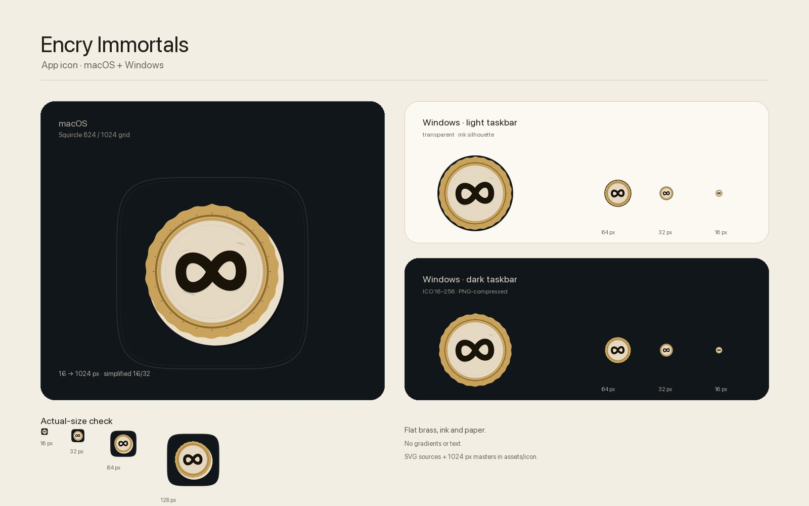
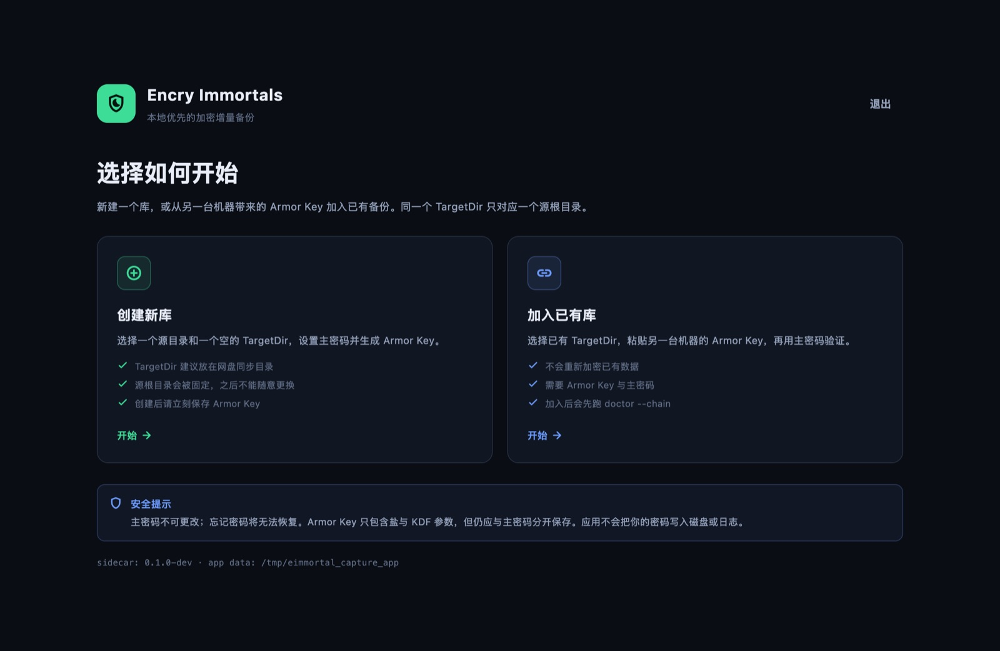
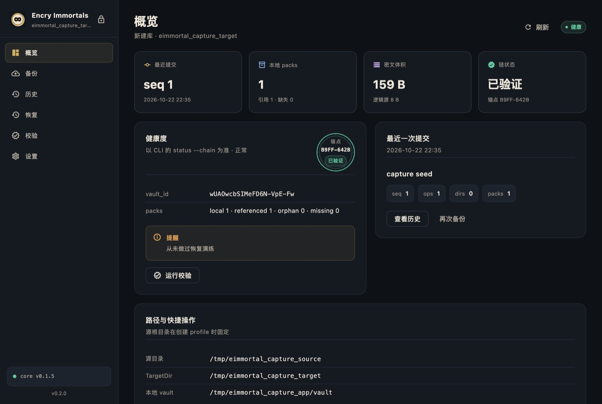
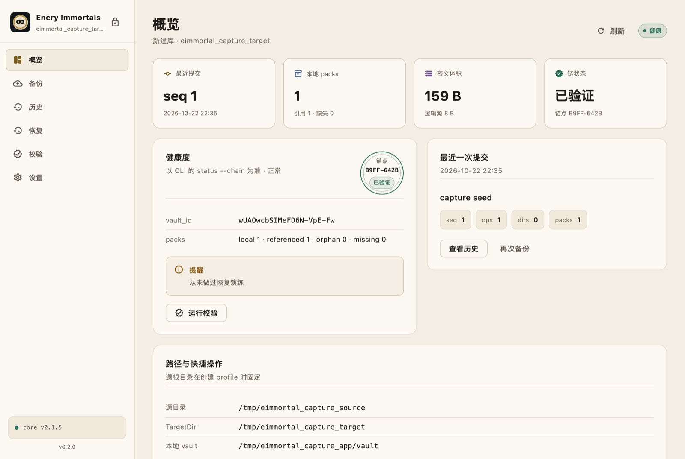

# encry-immortals-ui

[`encry-immortals`](https://github.com/tangthinker/encry-immortals)（eimmortal）的桌面客户端，目标平台 **macOS 12+ / Windows 10+**。

> 状态：**M1 MVP + 参数设置 + Apple HIG 设计打磨**（2026-10-22）。创建/加入库、解锁、仪表盘、备份、历史、恢复、校验、设置与 Key 导出均已可用；
> 遵循 macOS 系统浅色/深色外观，提供原生菜单栏与快捷键；release sidecar 固定 SHA-256 并验证。
> Windows 构建脚本已提供但尚未在 Windows 宿主实测；Developer ID 公证与 Authenticode 签名仍属于发布阶段工作。
>
> 技术结论见 [技术选型](docs/tech-selection.md)，进程与 JSON 契约见 [集成契约](docs/integration-contract.md)，
> 每轮开发记录见 [开发日志](docs/devlog.md)。









更多界面：[解锁](docs/assets/m1-unlock.jpg) · [解锁（浅色）](docs/assets/m1-unlock-light.jpg) · [备份](docs/assets/m1-backup.jpg) ·
[历史](docs/assets/m1-history.jpg) · [恢复](docs/assets/m1-restore.jpg) · [校验](docs/assets/m1-verify.jpg) ·
[设置](docs/assets/m1-settings.jpg) · [设置（浅色）](docs/assets/m1-settings-light.jpg) ·
[初始化参数](docs/assets/m1-onboarding-params.jpg) · [初始化参数（浅色）](docs/assets/m1-onboarding-params-light.jpg) ·
[设置参数](docs/assets/m1-settings-params.jpg) · [设置参数（浅色）](docs/assets/m1-settings-params-light.jpg)。

## 已实现功能

| 流程 | 内容 |
|---|---|
| 创建新库 | 选择源目录与空 TargetDir → 设置主密码 → 普通/高级参数 → `init` → `export-key` → 强制保存 Armor Key |
| 加入已有库 | 选择 TargetDir 与本地源目录 → 粘贴 Armor Key → 普通/高级参数 → `init --join` → `import-key` → 主密码验证 → `doctor --chain` |
| 解锁 | 以 `log --json` 作为密码探针；密码只保存在内存，锁定/退出即清除 |
| 概览 | `status --chain` 的健康度、锚点、pack 统计、密文/逻辑体积、最近提交与警告 |
| 备份 | 源根目录固定；`--dry-run` 预演；实时进度/日志；截断提示与继续备份；`--break-lock` 重试 |
| 历史 | `log` 提交列表、`show` 变更明细、`ls --at` 文件树与按路径过滤 |
| 恢复 | 强制 `doctor --chain` 预检 → `restore --list-packs` 检查缺失 → 覆盖策略 → `--dry-run` 或正式恢复；支持跳过缺失 pack / 等待同步 |
| 校验 | `verify --sample N` / `--deep` 与 `doctor --chain`，展示 PASS/WARN/FAIL、缺失/损坏/抽样失败 |
| 设置 | 查看 profile/路径/核心完整性；编辑全部已实现参数（普通/高级）；重新验证密码后导出 Armor Key；写锁诊断；立即锁定；移除本地配置 |
| 应用保护 | 单实例文件锁；关闭窗口时若命令仍在运行会阻止退出并确认取消；全命令串行队列 |
| 桌面体验 | 原生菜单栏（应用/文件/编辑/显示/操作/窗口/帮助）、⌘1–5/⌘⇧B/⌘, 等快捷键、内容化窗口标题、侧边栏顶部更多菜单 |

界面**不使用任何渐变**，跟随系统浅色/深色外观；不包含截图/自动自检等调试功能。

## 设计语言

- **方向**：把“锚点/封印”作为产品的签名元素——仪表盘健康卡展示由 `status --chain` 数据驱动的 `ChainSeal`，
  不是装饰性插画。
- **色彩**：深色为暖墨底 + 黄铜主操作 + 绿色“已验证 + 琥珀警告 + 红色危险；浅色为羊皮纸底 + 更深的黄铜/绿色。
  颜色均为语义角色，不硬编码系统色；系统外观切换即跟随，没有应用内主题开关。
- **对比度**：文字/状态色在背景与卡片表面的 WCAG AA 对比度由 `test/app/theme_contrast_test.dart` 强制校验
  （小字号要求 ≥ 4.5:1）。
- **层级**：系统字体负责导航/控件，Menlo 负责路径、hash、seq；桌面最小字号 10pt；控件保持 macOS 的紧凑命中区。
- **桌面惯例**：原生菜单栏、⌘1–5/⌘⇧B/⌘⇧R/⌘L/⌘, 等快捷键、内容化窗口标题、侧边栏顶部更多菜单；
  锁定不再放在侧边栏底部。
- **图标**：黄铜封印压在纸面上的“无穷/备份链”标记，不使用字母、钥匙或渐变。macOS 用 squircle 网格与 16/32 简化版；Windows 用透明背景 + 深色轮廓的 ICO。SVG 源文件与 1024px masters 在 `assets/icon/`，由 `tool/generate_icons.py` 生成平台资源。

## 参数模型

创建/加入库的第三步与设置页共用同一个表单（`VaultSettingsForm`），保存时写入 `config.toml` 并更新 `profile.json`。

| 分组 | 参数 | 说明 |
|---|---|---|
| 普通 | `storage.session_max_mib` | 单次 backup 的明文上限；超出会截断，剩余留给下次 |
| 普通 | `codec.zstd_level` | zstd 1..22；1 最快、5 均衡、19 归档 |
| 普通 | `scan.mode` | `fast`（mtime+size）或 `strict`（全量 hash） |
| 普通 | `scan.exclude` | 相对源目录的 glob，每行一条；空列表即不排除 |
| 高级 | `storage.pack_max_bytes` / `slice_plain_bytes` / `small_file_bytes` | 以 MiB 编辑；必须满足 slice/small + 50B ≤ pack，slice ≤ 64 MiB |
| 高级 | `codec.min_compress_bytes` | 以 KiB 编辑；0..1024 KiB |
| 高级 | `storage.staging_dir` | 留空使用 `<TargetDir>.tmp`；必须与 TargetDir 同卷 |
| 高级 | `scan.ignore_xattr` | macOS 建议开启；关闭后 E21 风险提示 |
| 高级 | `scan.sparse_max_bytes` / `follow_hardlinks` | 稀疏文件上限、硬链接策略 |
| 高级 | `on_change_during_read.strategy` | retry / skip / fail |

所有参数在写入前做跨字段校验；命令运行中禁用保存；修改结构参数或关闭 `ignore_xattr` 时会二次确认。

参考 Apple Human Interface Guidelines 与 [apple-design skill](https://github.com/dickwu/apple-design-skill)：
`accessibility`、`layout`、`typography`、`color`、`designing-for-macos`、`sidebars`、`toolbars`、`windows`、
`settings`、`the-menu-bar`、`keyboards`、`buttons`、`progress-indicators`。

## 安全模型

- 主密码只经 **stdin** 传给 sidecar，不进入 argv/env/临时文件/日志；应用不提供“记住密码”。
- `init` / `import-key` / `export-key` 被标记为敏感命令；stdout 不进入运行日志。Armor Key 只在内存与剪贴板中出现。
- 所有 CLI 调用经过全局单飞队列；sidecar 崩溃/取消不会带走 UI。
- 释放版 sidecar 位于 `Encry Immortals.app/Contents/Resources/bin/eimmortal`，构建期签名并固定 SHA-256；
  release 忽略 `EIMMORTAL_CORE_PATH`，启动与每次解锁前都会重新校验。
- `doctor --chain` 是恢复的硬性前置；FAIL 时应用不会自动继续。
- 本地控制平面（`vault.meta`/`state.db`/journal）在应用数据目录，TargetDir 只存密文；移除配置**不会删除 TargetDir**。
- macOS 已关闭 App Sandbox（备份工具需要读取用户目录，且要执行 sidecar）；分发应使用 Developer ID + 公证。
- 首次读取“桌面/文稿”等受保护目录时，macOS 可能要求完全磁盘访问权限。

## 开发

### 前置

- Flutter 3.47.5 / Dart 3.13.4
- Xcode + Command Line Tools（macOS）
- Go 1.27+（Debug sidecar 自动构建需要）
- 上游核心仓库以 git submodule 固定在 `third_party/encry-immortals`（tag `v0.1.5`）

### 运行（开发模式）

```bash
git submodule update --init --recursive
flutter --no-version-check pub get
flutter --no-version-check run -d macos
```

Debug 构建的 Xcode phase（`tool/xcode_debug_sidecar.sh`）会从 submodule 构建 sidecar 并放进
`Contents/Resources/bin/eimmortal`，因此 **不需要手动导出** `EIMMORTAL_CORE_PATH`。如果 Go 不在 PATH，
可以用 `./tool/build_core.sh` 生成缓存，或显式设置 `EIMMORTAL_CORE_PATH` 指向本地 sidecar。
`flutter --version` 的 GitHub 版本检查在本机会卡住，统一使用 `--no-version-check`。

### 测试

```bash
flutter --no-version-check analyze
flutter --no-version-check test                         # 72 个单元/组件测试，不需要 sidecar
flutter --no-version-check test test/core test/app      # 只跑非集成测试

# 真实链路：创建 → 备份 → 历史 → 恢复 → 校验 → 加入库
RUN_CORE_INTEGRATION=1 \
EIMMORTAL_CORE_PATH=/Users/tangthinker/code/go/encry-immortals/bin/eimmortal \
  flutter --no-version-check test test/integration
```

不启动 UI 的快速 core 冒烟：

```bash
dart run tool/vertical_slice.dart /path/to/eimmortal
```

### 构建 macOS release（带 sidecar）

```bash
./tool/build_macos.sh
```

默认使用 `third_party/encry-immortals`；如需临时使用另一个核心 checkout，可设置
`EIMMORTAL_CORE_REPO=/path/to/encry-immortals`。

脚本会：

1. 从核心仓库构建 `CGO_ENABLED=0` sidecar，记录 `git describe` 版本；
2. **先 codesign sidecar，再计算 SHA-256**（签名会改写 Mach-O，顺序不能反）；
3. 用 `--dart-define=EIMMORTAL_CORE_SHA256=...` 构建 Flutter release；
4. 把已签名 sidecar 放入 `Contents/Resources/bin/eimmortal`，签名整个 app；
5. 校验 bundle 内 sidecar 哈希与构建期常量一致。

产物：

```text
build/macos/Build/Products/Release/Encry Immortals.app
```

验证 bundle：

```bash
dart run tool/verify_bundle.dart \
  "build/macos/Build/Products/Release/Encry Immortals.app" \
  "$(cat build/core/eimmortal.sha256)"
# integrity: verified
```

当前默认使用 **ad-hoc 签名**，仅用于本机验证；正式分发需要 Developer ID、hardened runtime 与 notarization。
可设置 `CODESIGN_IDENTITY="Developer ID Application: …"` 让脚本使用带 runtime/timestamp 的正式签名。

### 构建 Windows（未实测）

```powershell
.\tool\build_windows.ps1 -CoreRepo C:\path\to\encry-immortals
```

脚本构建 `eimmortal.exe` 与 GUI 子系统 `eimmortal-gui.exe`，复制到 Flutter release 的 `bin\` 并写入 `core-build.txt`。
发布前需 Authenticode 签名，并验证 Windows 上 GUI 子系统 sidecar 的 stdio 与锁行为。

## 目录结构

```text
assets/icon/                ICON 设计源文件（SVG + 1024 PNG masters）
lib/
  app/
    app_controller.dart     启动/单实例/核心校验/profile/解锁状态机
    screens/                onboarding、解锁、主壳层与六个功能页
    widgets/                卡片、状态、日志、文件树、ChainSeal、VaultSettingsForm
  core/
    core_gateway.dart       sidecar 进程 IO、JSON、退出码、取消
    core_models.dart        CLI JSON 模型
    command_queue.dart      全局单飞队列
    app_paths.dart          macOS/Windows 应用数据目录
    profile*.dart           单 profile 持久化（0600），内嵌 VaultSettings
    vault_settings.dart     全部已实现 CLI 参数的模型/校验/序列化
    onboarding_service.dart 创建/加入库
    vault_session.dart      已解锁会话上的真实命令
    lock_inspector.dart     TargetDir/控制面写锁诊断
    progress.dart           stderr 进度解析（只用于显示）
    vertical_slice.dart     开发期真实链路冒烟
tool/
  build_core.sh             sidecar 构建 + 哈希
  build_macos.sh            release app + 签名 + 校验
  build_windows.ps1         Windows 构建（未实测）
  xcode_debug_sidecar.sh    Debug 构建自动注入 sidecar
  generate_icons.py         从 masters 生成 macOS 图标与 Windows ICO
  render_icon_svgs.py       从 SVG 重渲染 1024 PNG masters（需要 Chrome）
  verify_bundle.dart        bundle 路径/哈希/版本验证
  vertical_slice.dart       终端版冒烟
```

## 已知限制

- 单 profile；不做定时/无人值守备份、自动更新、多 vault、文件预览、`compact`/`gc` 图形化。
- 应用使用自己的控制平面（`~/Library/Application Support/EncryImmortals/vault`），不是 CLI 的 `~/.eimmortal`。
  不要用 CLI/GUI 或其他客户端同时操作同一个 TargetDir；控制锁与锚点状态可能分叉。
- Windows 构建与 GUI 子系统 stdio 未实测；Windows 控制锁仍需上游 `LockFileEx` 改造（见技术选型 P0）。
- macOS release 仅 ad-hoc 签名；未公证，未做 Apple Silicon + Intel universal 单包。
- 空闲自动锁定未实现（仅手动锁定/退出清除密码）；大快照的 `ls` 仍一次加载完整文件树。
- 设置是主窗口内的功能页（通过应用菜单 ⌘, 或侧边栏更多菜单进入），不是独立的 macOS 设置窗口；侧边栏暂不支持手动隐藏。
- 设置页可编辑全部**当前版本实际生效**的 CLI 参数；`concurrency.hashers`、`checkpoint.*`、`verify.auto_strict_every` 等上游尚未实现的字段不暴露。
- `TargetDir`、应用控制平面目录与源根目录在创建后固定；结构性参数（pack/slice/small_file）变更只影响后续提交，已有快照仍可读。
- 暂存目录要求与 TargetDir 同卷；UI 只做路径/绝对路径校验，实际同卷检查由 sidecar 在命令启动时完成。
- 菜单中的“备份/校验/恢复”是导航命令，具体参数仍需在对应页面确认后执行。
- 已做启动/备份后的 TargetDir 写锁检测与横幅提示，但尚未持久化“上次中断”的操作状态，也不会自动重试。
- 未单独提供 Increase Contrast 色板变体；基线对比度已满足 WCAG AA，系统原生控件会跟随系统增强。

## 文档

- [技术选型](docs/tech-selection.md) — Flutter + sidecar 的取舍、架构、打包、风险与待确认项。
- [客户端 ↔ 核心 CLI 集成契约](docs/integration-contract.md) — 逐命令能力矩阵、密码/stdin、退出码、JSON、锁/取消、契约测试清单。
- [开发日志](docs/devlog.md) — 每个里程碑的目标、操作、结果、决策与风险。

## 核心仓库

- <https://github.com/tangthinker/encry-immortals>
- 当前核心最新 tag：`v0.1.5`；发布时应固定到 tag/commit，并重跑集成契约测试。
