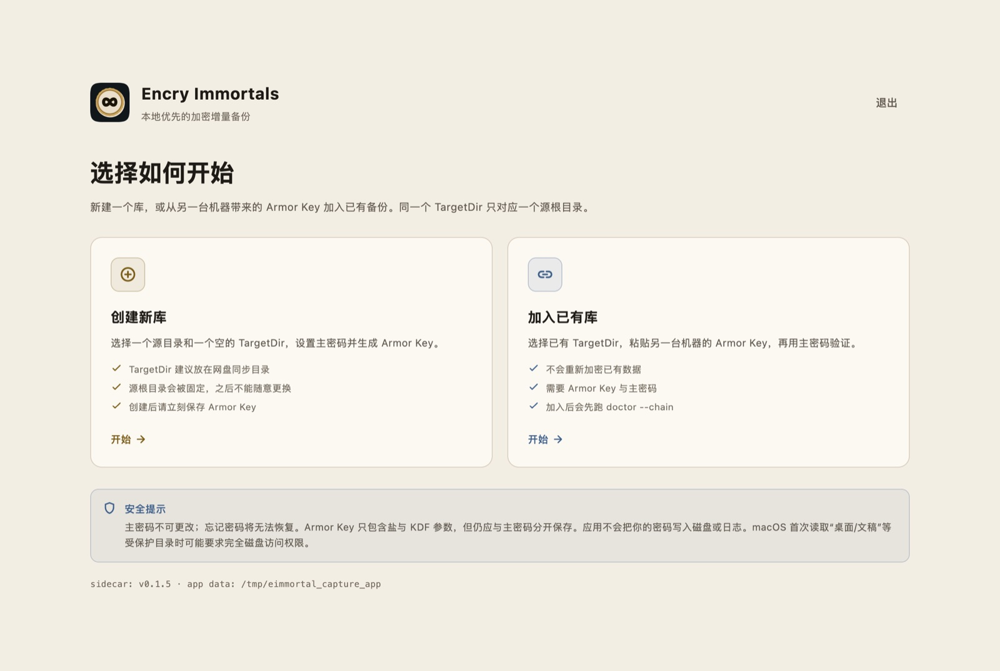
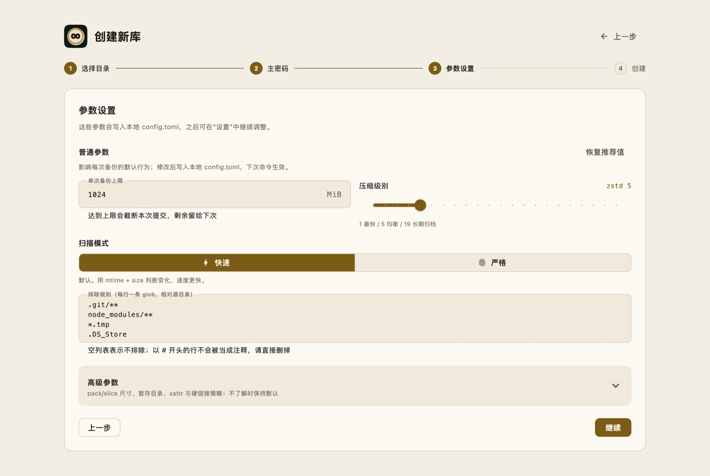
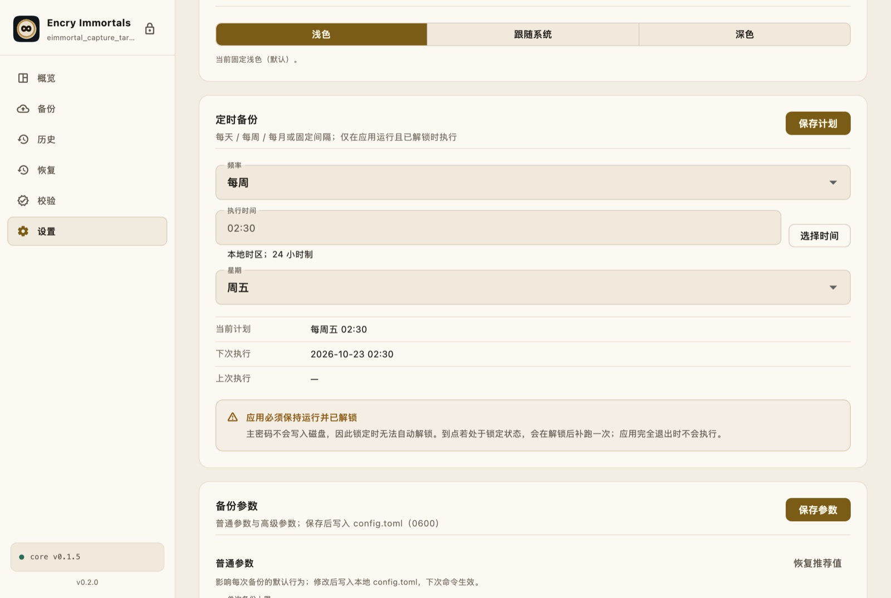
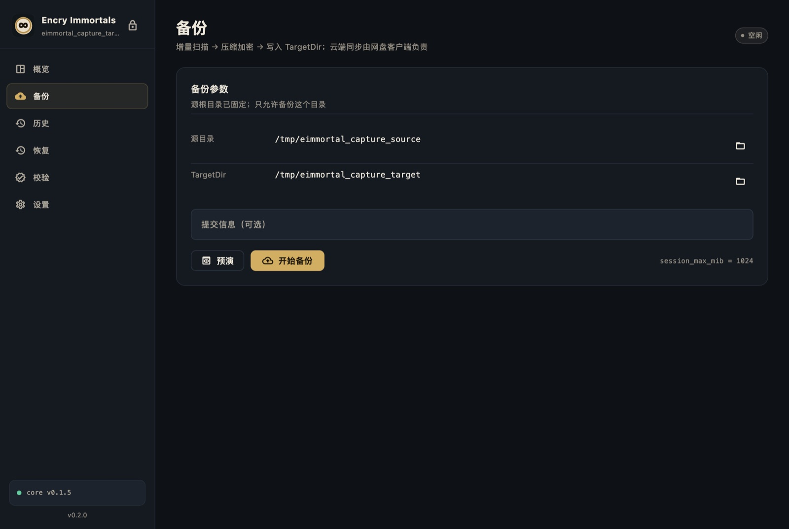
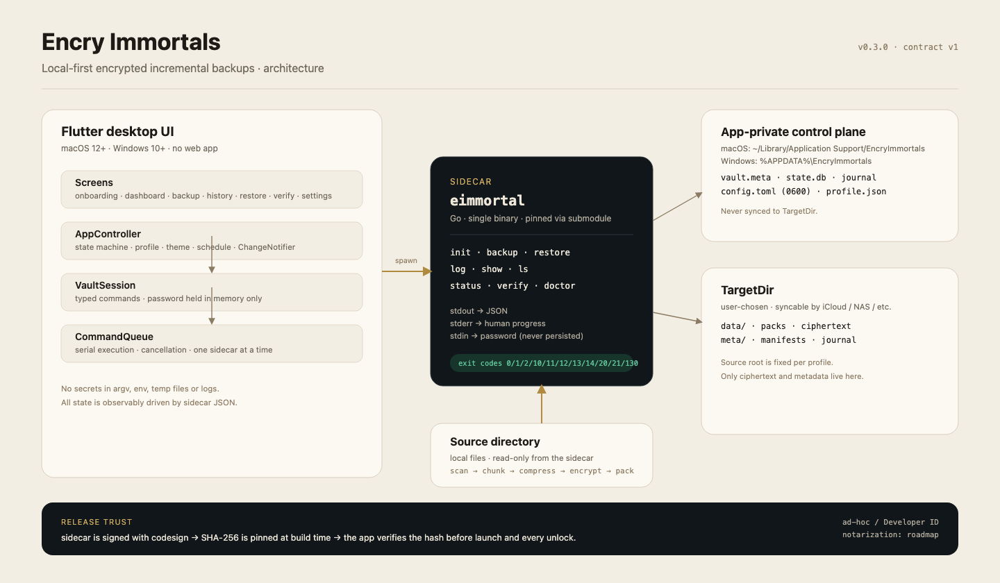

<p align="center">
  
</p>

<h1 align="center">Encry Immortals</h1>

<p align="center">
  <strong>本地优先、可验证、加密的增量备份桌面端。</strong><br>
  <sub>不需要账号，不锁定云服务，不把主密码写入磁盘。</sub>
</p>

<p align="center">
  <strong>简体中文</strong> · <a href="README.md">English</a>
</p>

<p align="center">
  <a href="https://github.com/tangthinker/encry-immortals-ui/releases"></a>
  <a href="https://github.com/tangthinker/encry-immortals-ui/actions/workflows/release.yml"></a>
  
  
  
  
</p>

> [!NOTE]
> **状态：MVP，持续开发中。** 最新 release `v0.3.0` 提供 **macOS universal 构建**（`x86_64 + arm64`）、
> 独立的 **Apple Silicon arm64 构建**，以及 **Windows x64 安装包 + portable zip**。macOS 使用 ad-hoc 签名，未公证；
> Windows 已由 CI 构建，但仍需在真实 Windows 宿主机验证并接入 Authenticode。

---

**目录：** [为什么](#为什么做-encry-immortals) · [截图](#快速预览) · [功能](#功能) · [架构](#架构) · [安全](#安全模型) · [下载](#下载与安装) · [构建](#从源码构建) · [路线图](#路线图--已知限制)

## 为什么做 Encry Immortals？

大多数备份工具要求你信任一个账号、一个同步服务，或者一个无法检查的私有格式。
Encry Immortals 选择另一条路：

- **本地库，链式封印。** 每次备份生成可验证的 commit；每次恢复前强制执行 `doctor --chain` 预检。
- **独立的 Go sidecar，不是黑盒。** UI 通过有类型的 JSON 契约调用 `eimmortal`；GUI 使用的是与 CLI 相同的核心能力。
- **不保存主密码。** 主密码只经 `stdin` 传给 sidecar，保存在内存中，锁定/退出即清除。
- **桌面应用，不是网页控制台。** 原生菜单栏、快捷键、可调整窗口，完全离线可用。

这是一个可以长期检查、迁移和接管的备份工作台，而不是另一个要你交出数据的订阅服务。

## 快速预览

<table>
  <tr>
    <td width="50%" align="center">
      <br>
      <sub><b>概览</b> · 浅色 · 链健康度、最近提交、存储事实</sub>
    </td>
    <td width="50%" align="center">
      <br>
      <sub><b>概览</b> · 深色 · 同样的信息层级</sub>
    </td>
  </tr>
  <tr>
    <td width="50%" align="center">
      <br>
      <sub><b>初始化</b> · 创建新库，或使用 Armor Key 加入已有库</sub>
    </td>
    <td width="50%" align="center">
      <br>
      <sub><b>参数设置</b> · 在第一条命令前配置普通/高级参数</sub>
    </td>
  </tr>
  <tr>
    <td width="50%" align="center">
      <br>
      <sub><b>定时备份</b> · 每天/每周/每月/固定间隔</sub>
    </td>
    <td width="50%" align="center">
      <br>
      <sub><b>备份</b> · dry-run、实时进度、日志与写锁恢复</sub>
    </td>
  </tr>
</table>

更多界面：**[解锁](docs/assets/m1-unlock.jpg)** · **[历史](docs/assets/m1-history.jpg)** · **[恢复](docs/assets/m1-restore.jpg)** · **[校验](docs/assets/m1-verify.jpg)** · **[设置](docs/assets/m1-settings-light.jpg)** · **[高级参数](docs/assets/m1-settings-params-light.jpg)**

## 功能

| 模块 | 内容 |
|---|---|
| **库生命周期** | 创建新库或加入已有 TargetDir；在第一条命令前选择存储、压缩、扫描、排除与完整性参数。 |
| **增量备份** | 扫描 → 切片 → zstd → 加密 → pack。支持 dry-run、实时进度/日志、截断提示、继续备份和 `--break-lock` 恢复。 |
| **持续备份** | 单次达到 `session_max_mib` 后，可保留“继续备份”再执行一次，或选择“持续备份到所有数据备份完毕”自动重复，并带停止与无进展保护。 |
| **历史与恢复** | commit 列表、变更明细、指定 `seq` 的文件树；恢复前强制 `doctor --chain` 预检，检查缺失 pack，支持覆盖策略。 |
| **完整性** | `verify --sample N` / `--deep` 与 chain doctor；PASS/WARN/FAIL、缺失/损坏/抽样失败均有明确展示。 |
| **参数设置** | 集中编辑当前实现的所有参数：pack/slice/small-file 尺寸、zstd、排除规则、暂存目录、xattr、硬链接、读取中变化策略。 |
| **定时备份** | 每天/每周/每月指定时间，或每 N 分钟/小时/天。计划持久化；应用运行且已解锁时自动执行。 |
| **桌面体验** | 原生菜单栏、`⌘1–5` / `⌘⇧B` / `⌘⇧R` / `⌘,` 快捷键、内容化窗口标题、侧边栏锁定、设置 tab、浅色/跟随系统/深色主题。 |
| **应用保护** | 单实例文件锁、串行命令队列、运行中关闭守卫、release sidecar SHA-256 校验。 |

## 架构

<p align="center">
  
</p>

```text
Flutter 页面
  → AppController / VaultSession
  → CommandQueue（同一时刻只有一个 sidecar）
  → eimmortal Go sidecar
  → TargetDir（密文 + 元数据）  +  应用私有控制平面
```

- UI 不直接修改 vault 文件，所有操作经过 sidecar 和有类型的 JSON 结果。
- sidecar 读取 `config.toml`（POSIX 权限 0600）；GUI 负责写入，且只写当前版本真正生效的参数。
- 控制平面（`vault.meta`、`state.db`、`journal`、`config.toml`）在应用数据目录；TargetDir 只保存密文和元数据。
- 核心以 submodule 固定在 `third_party/encry-immortals`，当前 tag 为 `v0.1.5`。
- release 信任链：先签名 sidecar，再计算 SHA-256，构建时固定哈希，启动与每次解锁前校验。

## 安全模型

| 边界 | 规则 |
|---|---|
| **主密码** | 只经 sidecar `stdin` 传入。绝不进入 argv、环境变量、临时文件、日志或分析服务；只存在内存，锁定/退出清除。 |
| **Armor Key** | 只有在用户显式导出并重新验证密码后才出现；不会写入日志。 |
| **控制平面** | 应用私有目录，POSIX `0600` 文件；`config.toml` 不含密钥。 |
| **TargetDir** | 只有密文和元数据。移除本地 profile 不会删除 TargetDir 或历史数据。 |
| **Sidecar 完整性** | release 构建固定已签名 sidecar 的 SHA-256，并在执行前校验；debug 使用 Xcode phase 注入的 ad-hoc sidecar。 |
| **恢复门禁** | `doctor --chain` 是硬性前置；FAIL 不会被静默忽略。 |
| **定时执行** | 调度器从不保存或索取主密码。到点锁定时等待，解锁后补跑。 |

> [!IMPORTANT]
> 当前 macOS release 使用 **ad-hoc 签名，未公证**。如果 Gatekeeper 阻止打开，请右键 → 打开，或执行 `xattr -dr com.apple.quarantine "Encry Immortals.app"`。

## 定时备份的边界

Encry Immortals 使用**应用内调度器**：

- 每天指定 `HH:mm`
- 每周指定星期 + 时间
- 每月指定日期 + 时间（短月份使用最后一天）
- 每 N 分钟 / 小时 / 天（5 分钟～30 天）

计划、`nextRunAt`、`lastRunAt`、`lastError` 都保存在 vault profile 中。

**应用必须保持运行并已解锁**，定时任务才会执行。主密码不落盘，所以调度器不能自行解锁；到点锁定时会在解锁后补跑一次，应用完全退出时不会后台执行，下次启动解锁后如已过期会补跑。它是应用内调度器，不是 launchd/Task Scheduler。

## 下载与安装

**macOS universal**（`x86_64 + arm64`）：

- [`Encry-Immortals-v0.3.0-macOS-universal.dmg`](https://github.com/tangthinker/encry-immortals-ui/releases/download/v0.3.0/Encry-Immortals-v0.3.0-macOS-universal.dmg)
- [`Encry-Immortals-v0.3.0-macOS-universal.zip`](https://github.com/tangthinker/encry-immortals-ui/releases/download/v0.3.0/Encry-Immortals-v0.3.0-macOS-universal.zip)

**macOS arm64**（Apple Silicon 专用）：

- [`Encry-Immortals-v0.3.0-macOS-arm64.dmg`](https://github.com/tangthinker/encry-immortals-ui/releases/download/v0.3.0/Encry-Immortals-v0.3.0-macOS-arm64.dmg)
- [`Encry-Immortals-v0.3.0-macOS-arm64.zip`](https://github.com/tangthinker/encry-immortals-ui/releases/download/v0.3.0/Encry-Immortals-v0.3.0-macOS-arm64.zip)

打开任一 DMG，把 **Encry Immortals** 拖入“应用程序”。两个构建都是 ad-hoc 签名、未公证。

**Windows x64**：

- [`Encry-Immortals-0.3.0-Windows-x64.exe`](https://github.com/tangthinker/encry-immortals-ui/releases/download/v0.3.0/Encry-Immortals-0.3.0-Windows-x64.exe) — Inno Setup 安装包（当前用户安装，不需要管理员权限）
- [`Encry-Immortals-0.3.0-Windows-x64-portable.zip`](https://github.com/tangthinker/encry-immortals-ui/releases/download/v0.3.0/Encry-Immortals-0.3.0-Windows-x64-portable.zip) — 免安装版本

Windows 产物目前**未签名**；Authenticode 与 Windows 实机验证仍在路线图中。

## 从源码构建

### 前置

- Flutter `3.47.5` / Dart `3.13.4`
- Xcode + Command Line Tools（macOS）
- Go `1.27+`（构建 sidecar）
- Git submodule

### 运行

```bash
git clone --recurse-submodules https://github.com/tangthinker/encry-immortals-ui.git
cd encry-immortals-ui
flutter --no-version-check pub get
flutter --no-version-check run -d macos
```

Xcode 的 **Debug/Profile Sidecar** phase 会从固定 submodule 编译 sidecar 并放进 app bundle；普通 `flutter run` 不需要手动设置 `EIMMORTAL_CORE_PATH`。

### 构建 release

```bash
./tool/build_macos.sh
dart run tool/verify_bundle.dart \
  "build/macos/Build/Products/Release/Encry Immortals.app" \
  "$(cat build/core/eimmortal.sha256)"
# integrity: verified
```

脚本会先签名 sidecar 再计算 hash，复制进 `Contents/Resources/bin/eimmortal`，签名整个 app，并验证 bundle 内哈希。

### 测试

```bash
flutter --no-version-check analyze
flutter --no-version-check test                     # 96 个单元/组件测试，3 个 integration 默认跳过
RUN_CORE_INTEGRATION=1 \
EIMMORTAL_CORE_PATH=/path/to/eimmortal \
  flutter --no-version-check test test/integration
```

## GitHub Actions

推送 `v*` tag 会触发 [`.github/workflows/release.yml`](.github/workflows/release.yml)：

1. 检出仓库和固定核心 submodule。
2. 安装 Flutter `3.47.5` 与 Go `1.27.1`。
3. 执行 `flutter analyze` 和测试。
4. 构建 universal sidecar、签名、固定 hash、构建 macOS app。
5. 校验并打包 universal 和 arm64 两套 `.zip` + `.dmg`。
6. 构建 Windows x64、校验 sidecar hash、生成 Inno Setup 安装包和 portable zip。
7. 把 universal、arm64 和 Windows 产物发布到 GitHub Release。

Windows 产物由 CI 构建，但在接入 Authenticode 前仍未签名。

## 目录结构

```text
lib/
  app/                         页面、组件、主题、控制器
  core/                        sidecar 网关、模型、队列、profile、设置
assets/icon/                   图标 SVG 源文件 + 1024px masters
tool/                          构建、bundle 校验、图标工具
macos/ · windows/              原生 runner 与资源
docs/                          技术说明、契约、开发日志、截图
third_party/encry-immortals/   固定 Go 核心 submodule（v0.1.5）
```

深入阅读：

- [技术选型](docs/tech-selection.md)
- [客户端 ↔ sidecar 契约](docs/integration-contract.md)
- [开发日志](docs/devlog.md)
- [图标设计说明](assets/icon/README.md)
- [macOS 签名与公证](docs/macos-signing.md)
- [Changelog](CHANGELOG.md)

## 设计

图标是一枚压在纸面上的黄铜封印：无穷符号代表“永续/备份链”，蜡封边、纸纤维和压印阴影全部是矢量几何；没有渐变、发光、字母或具象钥匙。

应用本身沿用同一套克制：深墨/黄铜/纸张的平面色块、系统字体、路径与 hash 使用 Menlo，默认浅色。页面切换尊重“减少动态效果”，两套外观的对比度都有 WCAG AA 测试覆盖。

<p align="center">
  
</p>

## 路线图 / 已知限制

- [ ] 验证 Windows 打包、GUI 子系统 stdio、`LockFileEx` 控制锁与 Authenticode。
- [ ] Developer ID 公证 + stapling；Apple Silicon / Intel universal 单包。
- [ ] 可选的系统级调度（launchd / Task Scheduler）+ 显式 Keychain opt-in，让应用关闭时也能备份。
- [ ] 空闲自动锁定、上次中断操作的启动恢复。
- [ ] 多 vault 与大快照分页浏览。
- [x] 应用内每天/每周/每月/固定间隔定时备份。
- [x] 完整参数设置、浅色/跟随系统/深色主题、原生菜单栏、新封印图标。

## 参与贡献

欢迎 issue 和 PR。提交前请：

1. 运行 `flutter --no-version-check analyze` 和 `flutter --no-version-check test`。
2. 保持客户端 ↔ sidecar 契约不变；见 [docs/integration-contract.md](docs/integration-contract.md)。
3. 不要提交密码、Armor Key、解密 fixture 或机器相关绝对路径。
4. 影响应用行为或打包的改动，请补一条开发日志。

## License

仓库目前尚未声明 License；在添加 License 之前，源码保留所有权利。如需再分发或复用，请先开 issue 联系维护者。

## 致谢

基于 [encry-immortals](https://github.com/tangthinker/encry-immortals)、Flutter、Go 和 Apple Human Interface Guidelines 构建。封印图形、无渐变配色和图标是为本项目设计的，不来自模板。
